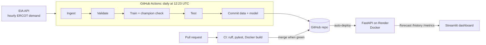

# ERCOT Demand Forecast: an end-to-end ML pipeline

[](https://github.com/Kashish24071/Ercot-Demand-Forecast/actions/workflows/ci.yml)
[](https://github.com/Kashish24071/Ercot-Demand-Forecast/actions/workflows/pipeline.yml)

Forecasts hourly electricity demand on the Texas grid (ERCOT) for the next 24 hours and flags
high-stress hours. Every morning, GitHub Actions pulls new data, validates it, retrains the model,
and redeploys the API, with no manual steps.

**Live dashboard:** https://ercot-demand-forecast.streamlit.app
**Live API docs:** https://ercot-demand-forecast.onrender.com/docs

> The API runs on a free tier and sleeps when idle, so the first load can take up to a minute.

## Results

| Model | MAPE (last 14 days) |
| --- | --- |
| Gradient boosting (this project) | **4.3%** |
| Naive baseline (same hour last week) | 17.1% |

Measured on a 14-day time-based holdout in October 2026. The model's error is about 4x lower than
the baseline's. Live, updated numbers are at [`/metrics`](https://ercot-demand-forecast.onrender.com/metrics).

## How it works



1. **Ingest** (`src/ingest.py`): incremental, idempotent load of hourly demand from the EIA Open
   Data API into `data/demand.parquet` (about 26,000 hours since October 2023).
2. **Validate** (`src/validate.py`): checks uniqueness, completeness, validity (range), continuity
   (gaps) and freshness. Any failure stops the pipeline before training.
3. **Train and evaluate** (`src/train.py`): scikit-learn `HistGradientBoostingRegressor` on calendar
   features plus 24/48/168-hour lags. A champion/challenger check replaces the saved model only if
   the new one scores at least as well on the same holdout window.
4. **Test**: pytest covers feature logic, validation rules and the API.
5. **Commit**: the bot commits the new data and model; Render redeploys the API automatically.
6. **Serve** (`api/main.py`): FastAPI endpoints `/forecast`, `/history`, `/metrics`, `/health`.
7. **Visualize** (`dashboard/app.py`): a Streamlit dashboard of actual vs. forecast demand and
   upcoming high-stress hours (forecasts at or above the past year's 95th percentile).

## Tech stack

Python 3.13 · pandas · scikit-learn · FastAPI · Docker · GitHub Actions · Render · Streamlit · pytest · ruff

## Run locally

```bash
git clone https://github.com/Kashish24071/Ercot-Demand-Forecast.git
cd Ercot-Demand-Forecast
python -m venv .venv && source .venv/Scripts/activate   # macOS/Linux: .venv/bin/activate
pip install -r requirements.txt

export EIA_API_KEY="your-key"          # free key from eia.gov/opendata
python src/ingest.py && python src/validate.py && python src/train.py
pytest -v

uvicorn api.main:app --reload          # API at http://localhost:8000/docs
pip install -r dashboard/requirements.txt
streamlit run dashboard/app.py         # dashboard at http://localhost:8501
```

## Limitations and next steps

- Forecasts start from the latest available hour; EIA data usually lags real time by a few hours.
- No weather inputs yet. Temperature is the biggest driver of Texas demand, so adding Open-Meteo
  forecasts for major cities is the next accuracy improvement.
- Planned: a dedicated peak-hour classifier, alerting when error drifts above a threshold, and
  moving data storage to the cloud as it grows.
